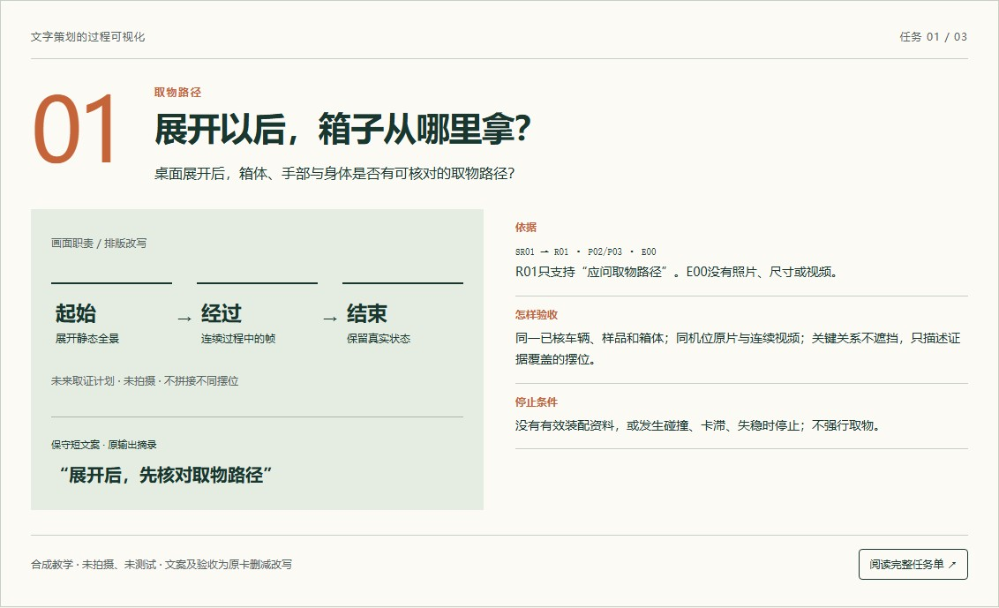
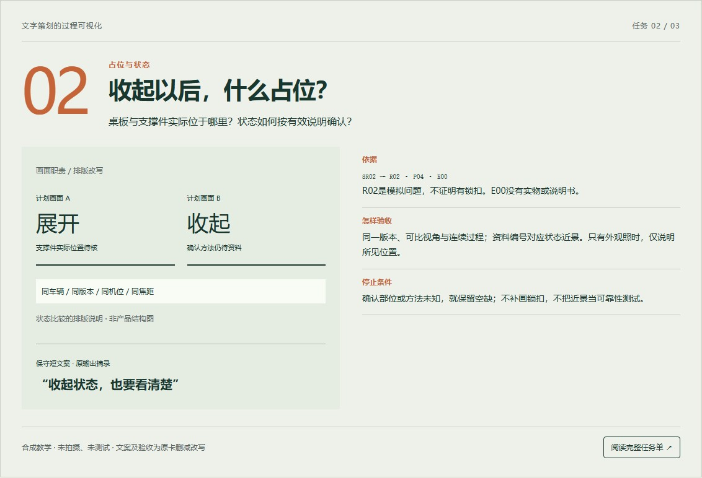
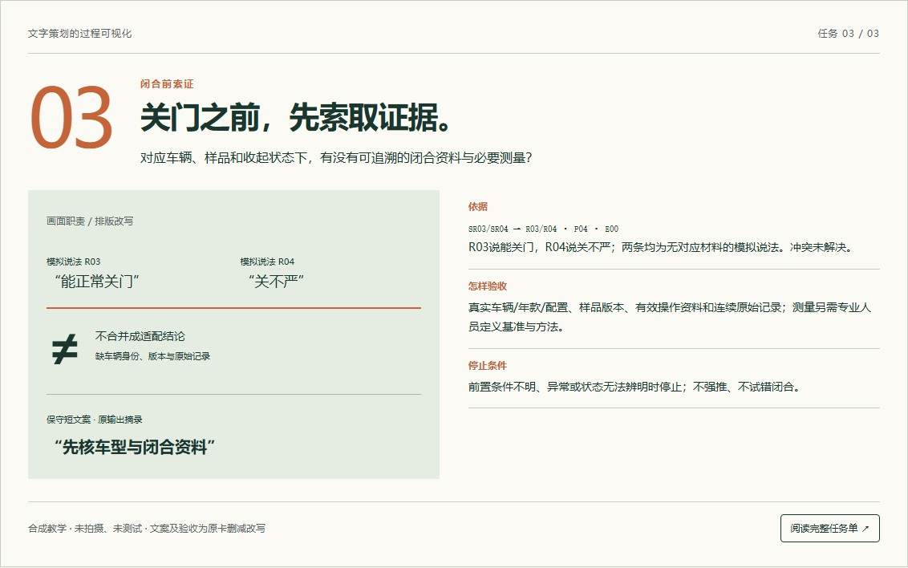

# 电商商品图如何从买家疑问变成三张可验收的策划卡

商品图需求里，“突出稳固”“展示方便”很常见，摄影师却难以据此决定拍什么。更清楚的交接方式，是先确定买家要判断的问题，再把每张图写成有来源、有动作条件、有验收边界的任务。下面用一个尾门折叠桌的合成教学案例，走完这条路径。

## 先说清楚案例是什么

我是 PDBen-Auto，参与开发了配套的文字图片策划工具，本文由 AI 辅助整理。本文复用的是作者在2026年11月6日完成的一次本地自测：作者手动加载了完整策划契约，使用自行编写的产品设定和四条模拟提问，得到三张文字策划卡。本次是把当时结果重新编排成方法文章，没有重新运行，也不是独立用户采用、客户项目或市场调研。没有生成商品图，没有完成实物拍摄、安装或测试。

教学对象是一个尾门折叠桌概念，车辆只设为待核通用SUV场景。没有品牌、车型、年款、配置、安装位置或真实SKU结论。材质、尺寸、承重、孔距、锁止结构和闭合安全等资料也都缺失。因此，文章讨论的是怎样准备取证与设计任务，不能据此判断某辆车能否安装、桌板能否承重，或任何动作是否安全。

## 一、把信息分成三层，别让问题冒充证据

第一层是输入设定：希望讨论展开与收起两种状态，读者关心取物、收纳和闭合。这层能帮助选择画面问题，却不能证明样品真的具备相应结构。

第二层是模拟提问。SR01问“桌面展开以后，后面的箱子还能拿出来吗？”；SR02问“收起来之后，怎么确认桌板锁住了？”；SR03说装好后能关门，SR04却说关不严。四条都是作者自行编写，没有真实评论总数、来源样本或需求频率。它们只负责提醒我们问什么，不负责回答产品做到了什么。

第三层才是实物证据。在本例中，E00明确表示没有实物照片、CAD、说明书、配件清单、测量或测试报告。两条互相矛盾的闭合说法无法核对车辆和样品版本，应保留为未解决的冲突，而不是挑一条相信，更不能自行解释成某两个车型的差异。

实际项目也可以沿用这三层。先给每条材料一个稳定编号，记录它来自产品负责人、评论、照片还是报告；然后写明“能支持什么”和“不能支持什么”。当设计师找不到一句文案对应的来源时，先把它改成待补证问题，往往比继续润色措辞更有效。

## 二、按购买问题排图序，不按形容词堆卖点

本例的图序是：展开时怎样取物，收起时怎样看清占位和状态，闭合前还缺哪些对应资料。三张各有一个职责。这个顺序是本次策划判断，不是经过转化测试的最优顺序，也不说明每个商品都应该做三张。

如果第一张已经解释了完整使用关系，第二张就不必再用另一张桌面特写重复同一句话。反过来，如果没有足够证据支持第三张公开展示，保留内部索证清单比补一张看似完整的效果图更诚实。图数是任务上限，问题是否被解释清楚才是判断依据。

## 三、第一张：展开以后，箱子从哪里拿

第一张回答取物路径。原策划把完整尾部、桌板和箱体放在同一场景里，并计划保留同机位动作序列。这样做是为了让设计师核对箱口、桌板边缘与人手的关系，而不是只拍桌面、让买家自己猜空间。

这里的动作还没有发生。产品负责人应先确认车辆、样品版本、箱体身份和有效操作资料，专业人员核实实际条件。条件满足并获准后，摄影师才记录起始、经过与结束的连续过程。不要拼接不同摆位冒充同一次取物成功，也不要为了拍摄强行取物、尝试未知装配。

这张卡的验收不应写成“看起来很方便”。更具体的检查是：关键关系有没有被裁掉；原片与连续视频能否对应同一车辆、样品和箱体；镜头是否利用广角夸大空隙；如果结论只适用于某种摆位，文案有没有保留这一范围。没有原始资料时，版式只能标作待真实取证。保守短句可以是“展开后，先核对取物路径”，不能提前写“拿物无阻”。

*过程图1｜原文字策划的删减改写与排版说明；合成教学，未拍摄、未测试，不是完整任务单或产品结构图。图中按钮样式仅为静态画面。*

## 四、第二张：收起以后，什么占位，如何确认状态

第二张关注收起状态。原策划要求展开与收起使用同一车辆、样品版本、机位和焦距，另外留出结构近景及资料出处的位置。可比条件比“左右各放一张照片”更重要：如果为了好看挪走了旁边的箱子，读者就难以判断变化来自桌板还是场景。

模拟提问里出现了“锁住”二字，不代表实际样品存在锁扣。结构近景只能对准有效资料指明的状态确认部位，不能根据概念外观补画一个锁扣。没有起止点、方向和测量基准时，也不要加确定厚度或占位尺寸箭头。

拍到收起后的外观，只能说明画面中所见的位置。要写状态如何确认，需要有效说明和对应近景；要谈锁止可靠、耐久或耐振，则需要其他验证，不能由一张近照代替。验收时应要求同版本、可比视角、连续过程与资料编号一一对应。缺少确认方法，就在任务单里留下“确认方式待补”，而不是用“稳固不晃”填空。

*过程图2｜原文字策划的删减改写与排版说明；合成教学，未拍摄、未测试，不是完整任务单或产品结构图。图中按钮样式仅为静态画面。*

## 五、第三张：闭合之前，先把冲突留在桌面上

第三张不展示“已经安全关门”的结果，职责是说明还需要索取哪些对应证据。SR03与SR04一正一反，却都没有车型、版本和原始影像。它们只能说明输入里存在待解冲突，不能证明适配或不适配。

原策划先要求车辆与样品身份、收起状态全景，再拍专业人员明确界定的待核部位。如果需要测量，基准、方向、起止点和方法必须另由专业人员定义，设计师不能凭排版需要猜一条测量线。是否能进行闭合取证，也由专业人员依据装配资料和安全条件决定；任务单不是操作许可。

若获准进行记录，原始连续视频应保留真实终止状态和异常。遇到卡滞、条件不明或无法辨认状态时应停止，不强推，不通过剪掉异常来制造成功。即使后来取得某一组合的闭合记录，也不能把它扩大为全车型通用，更不能代替承重、异响、耐久、路试和完整安全验证。证据不足时，这一张继续作为内部索证清单，不能变成公开适配证明。

*过程图3｜原文字策划的删减改写与排版说明；合成教学，未拍摄、未测试，不是完整任务单或产品结构图。图中按钮样式仅为静态画面。*

## 六、让FABE落到画面，而不是把未知写成优势

FABE可以作为卡片检查框架，但不能机械填满。F写可确认的特征或明确的教学设定；实际结构未知，就写未知。A说明为什么选择这种展示或取证方法，不能把方法优势偷换成产品“无干涉”的优势。B写希望帮助买家做出的判断，并标明它仍是策划假设，不能承诺节省时间或提升转化。E则指出真实证据在哪里、还缺什么；一条模拟问题不是功能证明。

例如第一张中，连续过程比单张桌面特写提供更多可核对信息，是取证方法的理由；“取物一定顺畅”却是另一项尚未成立的产品结论。区分这两件事，能让卡片既有可执行的设计方向，又不靠虚构产品事实维持完整。

每张完整任务单还应交代布局、拍摄对象与角度、逐帧计划、短文案、证据状态、验收条件和下一位负责人。设计师收到的就不是一段抽象赞美，而是一份能看见前置条件、资料缺口与交接动作的工作说明。

## 七、把交接做成可回查的闭环

交接先从产品负责人补资料开始，再由专业人员确认样品与操作范围，摄影师记录原片、视频和缺口，设计师按已核证据排版，最后由负责人复核事实和当前平台规则。哪一步材料不足，就把任务退回对应角色，不用设计效果掩盖缺口。

实际交付时，可以逐项问五个问题：这张图只回答哪个问题？每句文案对应什么来源？画面需要哪个对象和状态？什么条件下应停止取证？什么材料到齐后才算验收通过？回答不了的地方应写清楚待补项、负责人和用途限制。

本例暂用4:5工作草图讨论，不代表已经核实任何平台的主图或副图规范。策划稿、补证完成、拍摄完成和正式发布应分别记录。三张任务单的价值，是让下一位执行者知道该做什么、还不能说什么；图片是否好用、买家是否采用、是否改善经营结果，都需要后续真实证据，不能由作者自测推出。

案例来源：作者在2026年11月6日完成的本地合成自测实际输入、实际输出与运行记录。本文复用历史手动加载结果，不是新运行或独立用户采用；正文保留完整的方法讲解，三张过程图为原策划的删减改写，不是完整任务单或实物验证。图中“阅读完整任务单”的按钮样式是原过程图的静态画面，不是可点击控件，本页不承诺提供配套完整任务单。本文不提供安装指导、产品性能结论、购买链接或平台发布承诺。
